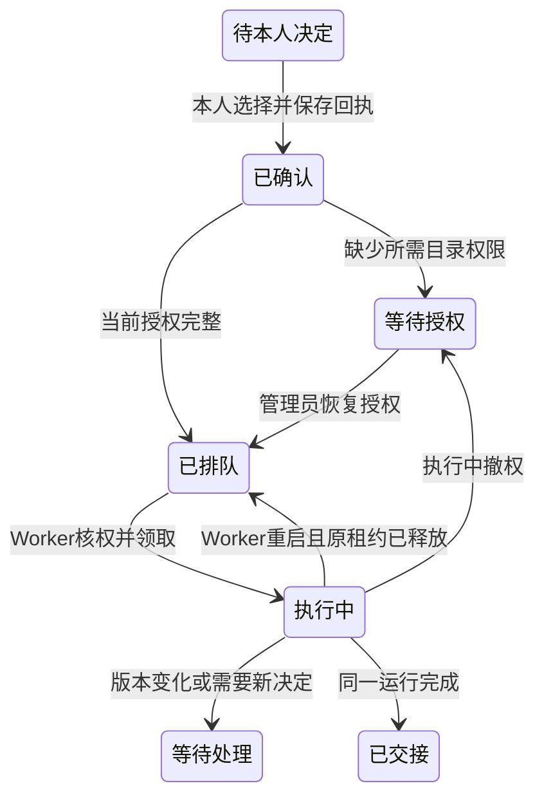

# 待我决策、授权与持久续跑（#7）

基于 #6 的需求群和 Pi SDK。决定状态与执行状态分别记录：本人已作决定时，即使执行权限不足，也保留原答复与回执。运行不更换编号，所采用的需求、阶段、上下文代次及检查点可追溯。

## 页面

「待我决策」分为待确认、已确认待继续和历史记录。每项显示项目/需求、问题、原始证据、运行编号、检查点、当前执行状态和阻塞原因。深链接可定位单个决定；确认失败保留输入，回执不明可用同一答复重试。已确认项展示原答复及不可改写的决定回执，提供重试续跑入口；缺授权时列出目录和所需权限，不能以点击重试绕过授权。

项目成员页提供「产物目录授权」。管理员创建项目内受管理的产物目录，为成员授予或撤回读/写权限。研发需求群可选择所需的产物目录；Agent 的工具目录保持一致，业务服务在每次受保护操作时检查该账号、项目、运行和目录授权。

管理员可从需求群改派待决定或已确认但阻塞的运行。必须选择同岗位、具备全部所需资源权限且满足独立验收约束的替补。先展示合格候选；没有候选时保留等待并记录升级原因。转交保存原答复、原检查点、配置快照及贡献者，增加执行修订以拒绝旧 Agent 的迟到回调。旧通知不能再次提交，已确认的决定不要求替补重选；替补核对交接后续跑。

## 持久化和外部作用

PostgreSQL 的续跑队列与决定回执在同一事务提交。应用启动时扫描未完成队列；进程内快捷处理与独立 Worker 复用同一领取方法，用数据库租约防止并发执行。恢复前重新核对成员、岗位、阶段、需求版本、上下文及目录授权。撤权不会清除已保存决定；移出项目则拒绝原账号访问，由管理员决定是否改派。

首个受保护作用是向应用管理的项目产物目录发布不可变文本。产物操作以运行、上下文代次、目录和业务操作键幂等；先写临时文件，再原子发布完整文件，回执带产物编号和摘要。文件已发布但数据库回执未提交时，重试核对同一文件摘要后复用，内容不同则冲突，不能覆盖。此契约不声称任意外部服务可做到严格一次写入；后续执行器必须实现同等幂等或结果核对接口。

## 独立验收

1. 本人决定：真实 API/Pi Worker 路径等待后确认，仅原运行从已保存检查点继续；他人、旧修订和冲突答复被拒，相同答复返回原回执。
2. 目录撤权：决定前撤权仍可确认，显示已确认且等待授权，文件和模型步骤不推进；恢复授权后队列只执行一次。执行中撤权也在后续保护操作前停止。
3. 改派：移除原成员、旧通知拒绝；同岗且有资源权限的替补接手相同证据及检查点，旧执行修订不能写入或覆盖新状态；不合格替补被拒，无替补时保留等待及升级记录。
4. 重启：在确认已提交但 Worker 未启动、Worker 正在执行、外部文件已发布但数据库回执未提交三处中断，再启动 Worker，原运行可恢复，已成功步骤及同一产物不重复发布。
5. 界面：从通知深链接打开、确认后查看等待状态、管理员恢复授权、替补接手、原成员旧入口失效；验证错误、键盘、深浅色和窄窗口。
