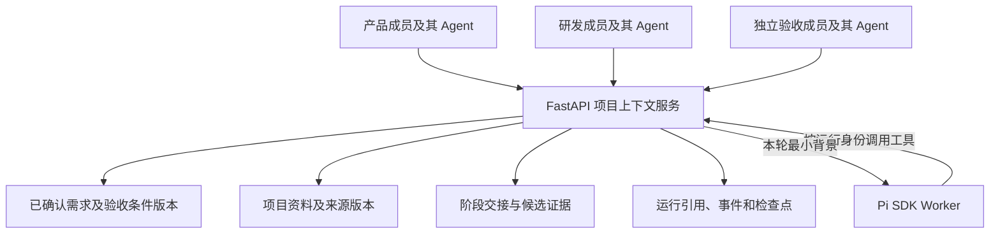

# 项目上下文与 Agent 交接

需求群、三岗位接力和本人决策的进一步实现见[需求群与阶段设计](REQUIREMENT_GROUPS.md)。

实施由 [#5](https://github.com/lkun-lea/myagentdesk/issues/5) 和 [#6](https://github.com/lkun-lea/myagentdesk/issues/6) 共同完成。每个账号持有稳定的个人 Agent，任务运行和个人会话分别隔离。项目服务持有共享需求、资料、决定、交接和证据，各角色的 Agent 通过受权工具按需读取同一份来源。

## 信息归属与共享

| 对象 | 归属与写入 | 读取与版本 |
| --- | --- | --- |
| 已确认需求 | 项目负责人确认标题、范围和验收条件 | 运行启动固定需求修订，变更通过预期修订检查追加 |
| 项目资料 | 项目管理员发布，附标题、来源和内容 | 目录仅返回摘要与版本，读取正文时保存版本与片段引用 |
| 决策 | 有权限的成员确认后发布 | Agent 建议保留待确认状态，确认者及生效版本可回查 |
| 交接 | 本阶段负责人提交，绑定需求修订和候选 | 下一阶段获得交付摘要、未解决问题和原证据引用 |
| 运行与证据 | 平台记录实际工具输入、输出、状态和引用 | 按运行编号查询，读取时重新核对项目权限 |
| 个人会话 | 本人与个人 Agent | 分享时由本人显式发布摘要与来源，私聊默认保持个人范围 |

新运行至少带入当前需求、验收条件、执行职责和固定版本。资料目录有数量上限，正文按范围读取并保留来源。对历史记录、私聊和其他项目的检索、预览与引用分别核权。原文作为资料内容处理，平台规则、职责和授权由服务端确定。

## 变更与恢复

1. 需求和资料追加版本，旧版本保留。写入使用预期版本，冲突返回最新修订，避免覆盖其他成员的决定。
2. 运行记录需求版本、个人配置快照、读取过的资料版本与片段。恢复时比较当前需求及实际引用的资料版本。发现变化后进入待确认，显示变更来源和受影响的引用。
3. 本人确认新的上下文后，平台记录确认，刷新当前需求与引用，按原运行编号继续。版本变更使旧交接和验收状态过期，历史证据继续可查。
4. 模型调用前、工具执行前和提交交接前核对成员、岗位与修订。取消和故障保留已完成的工具回执及检查点。进程中断后可重试领取同一运行，执行中有租约，已提交的工具调用按运行编号和调用编号去重。
5. 交付由研发成员提交给独立验收成员，验收者与实现者必须不同。独立验收读取相同的需求修订、候选和证据，附自己的验证结果。需要产品取舍时提交问题，由负责人决定后接续。

## SDK 与接口

Pi SDK 负责模型与工具循环。Python 项目服务负责权限、持久记录、版本冲突和交接，Node Worker 通过受控通道请求业务工具。账号身份由当前运行绑定，工具参数中的项目或账号字段不能改变授权范围。

首版工具涵盖列出资料、读取指定资料片段和提交阶段交接。模型每轮看到当前职责、需求、验收条件及本运行已完成回执。恢复继续使用原运行编号，已完成回执作为检查点带入后续轮次。

内部工具先调用项目服务。后续 MCP 接口复用这些业务服务和权限核验，供支持 MCP 的外部客户端访问。ACP 适配用于连接外部编码 Agent 的会话和执行生命周期。二者的接入由对应执行器 issue 负责。

## 可执行验收

- [ ] 两个账号并发首次访问仅各生成一个 Agent，模型与 Skill 配置隔离，新运行固定配置快照，旧运行保留原值。
- [ ] 在两个项目发布同名资料，授权运行只能检索本项目。目录不带正文，读取范围受限，回执可查资料版本、来源及实际片段。撤权后再次读、恢复和查询都被拒。
- [ ] 用官方 Pi SDK 加假模型端点，执行目录查询、片段读取、研发交付与独立验收。运行详情显示工具结果和交接引用，检验实际 SDK 请求与工具回调。
- [ ] 开始运行后修改需求或已读资料。下一次执行发现变化并暂停。本人确认后同一运行采用新版本继续，旧交付和验收标明过期。迟到的旧版本回执无法推进当前需求。
- [ ] 中途取消或进程退出后恢复，已成功的交接只有一条。并发恢复仅一个执行者领取，检查点、读取记录和候选关系保持一致。
- [ ] 研发本人尝试独立验收被拒，另一位有验收岗位的成员可提交。构造缺少证据、未交付、过期候选和重复工具回调，状态保持一致。
- [ ] 用明确授权的测试模型完成一次有真实读取与交付结果的样本，单独记录模型、时间、运行编号、实际证据与仍未验证的范围。公开文档排除凭据和个人会话。

完整需求群、外部仓库执行、文件目录授权、人工决策列表和发布放行分别由 #6、#14、#5、#7 和 #11 继续交付。本次先验证项目资料到阶段交接的最小闭环。

## 首个实现切片与实测

本次使用官方 `@earendil-works/pi-agent-core` 与 `@earendil-works/pi-ai` 1.5.2，运行环境要求 Node.js 22.19+。FastAPI 通过标准输入输出连接一次运行的 Pi Worker，模型调用和工具调度由 SDK 执行。资料、需求修订、工具回执和检查点保存到 PostgreSQL。数据库锁保证同一运行只有一个执行者，工具回执与业务提交在同一事务内保存。接入 MCP 或 ACP 时复用当前业务服务。

页面入口包括「我的 Agent」的模型与内置 Skill 配置、项目成员的岗位分配、资料原文与追加版本、需求确认与修订、运行创建与恢复、原文引用和共享交接。原文及历史引用可以从页面打开。资料发生变化后，需要确认当前需求与实际引用资料的最新版本，随后才可继续原运行。

[桌面运行页面](project-pages/context-run.png)与[窄窗口深色页面](project-pages/context-run-mobile.png)使用隔离账号和示例资料，记录了需求与原运行检查点继续的界面。

2026-11-18 使用 tebb 已有模型配置中的 `deepseek-flash` 完成真实模型样本，授权配置从外部 `.env` 读取。测试数据为单独创建的示例发布规则，身份通过隔离邮箱协议替身建立。研发运行 `1b034c0b-71b7-4dbb-bdf1-4787f1d7a5ae` 完成 4 次工具调用，独立测试成员的运行 `18c5ba54-ab63-460f-a02b-b6554941ecc8` 完成 7 次工具调用。双方独立读取同一份 v1 资料，测试还读取研发交接。两份交接均包含预期的 Cedar 发布代号及 `fixture://release-rules/v1` 来源。样本验证项目资料审阅与交接，测试 schema 在结束后移除。

假模型验收经过真实 Pi SDK、HTTP 模型端点、工具回调及 PostgreSQL。覆盖账号唯一 Agent、配置快照、独立验收、跨项目读取限制、撤权、需求及资料变更、确认新版本、取消、并发领取、模型失败及进程退出后的检查点恢复。完整需求群和文件执行授权继续在 #6 与 #5 交付，业务界面及真实编码验收随对应模块补齐。

[脱敏的真实运行证据](../evals/pi-context-20261118.json)保留运行编号、实际工具名称、读到的资料片段、候选关联和验收结果。执行器的模型服务凭据继续由 tebb 的外部配置提供。
