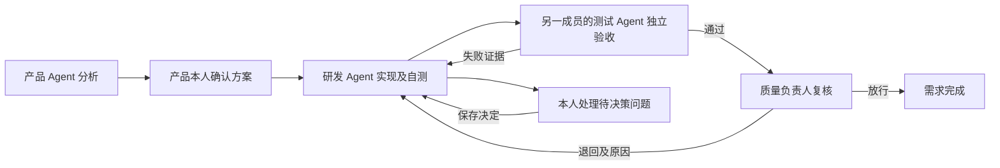

# 需求群、阶段交接与本人决策

实施对应 #6，使用 #5 的个人 Agent 和 Pi SDK，并接入 #7 的运行内决策契约。正式需求由有权限的人立项，需求与群一一对应。项目成员在需求页和聊天入口查看同一份群记录，阶段、负责人和证据都取自服务端。

## 交互与状态

- 立项时选择同一项目中的产品、研发、测试成员和质量负责人，研发与测试成员不同。重复立项或请求回执丢失时，返回原需求群。来源字段可关联真实 GitHub Issue。
- 正常建群后自动启动产品 Agent，产品本人确认后自动交给研发，研发交付后自动交给测试。等待决定、方案确认、质量复核或执行失败时停止自动接力，后续可以从原阶段恢复。每次自动接力最多推进 12 个阶段，达到限制后显示需关注的返工记录。分阶段验收可用 `auto_run=false` 分别启动。
- 群内显示阶段进度、当前负责人和下一步。人可以发布讨论消息，Agent 的交付、问题、决定与阶段变化由业务服务写入，记录原运行编号、需求修订和阶段修订。按消息序号增量读取并去重。
- Agent 初始只接收本阶段需求和最近的有界群记录，历史讨论通过当前需求群的读取工具按消息游标获取，每次至多 20 条。
- 产品 Agent 按项目原文和验收条件给出方案及证据。产品本人核对后确认进入研发。实现与自测、独立验收分别由相应成员的 Agent 执行。测试读取当前研发候选及其原始证据，再提交通过或带证据退回。
- 阶段流转使用预期修订。每个阶段修订最多一个运行，迟到回调和重复提交无法覆盖当前阶段。需求修订后回到产品确认，原阶段记录继续可查。
- 质量负责人核对同版本、当前候选的测试结论后确认完成，也可说明原因退回。需求完成与正式发布分别记录，构建和发布由 #11 接入。

## 本人决策与恢复

Agent 使用请求决策工具提交具体问题、可选方案及已有证据。请求绑定本人、需求、阶段、原运行、上下文代次和检查点。平台保存工具回执后将运行标为等待决策，群内和「待我决策」显示同一条通知。

本人选择方案并填写说明后，服务端核对身份、岗位、当前需求与阶段。重复提交同一个答复返回原回执，不同答复冲突。决定作为共享项目记录和本运行的上下文保存，随后通过 Pi SDK 在相同运行编号和检查点后继续，已完成工具结果继续使用。

Pi 输入明确携带当前运行编号、上下文代次和检查点，历史群消息的运行编号不能代替当前运行。决策请求和答复的共享记录也携带权威运行编号、原检查点及代次，测试可按群内证据独立核对接续关系。

需求或资料已变化时要求先核对上下文，旧决策入口随阶段修订失效。撤权成员不能查看或提交。项目管理员可以将等待中的决定和运行交给同岗位的合格替补，保留原检查点、配置快照及转交记录，旧本人入口随转交失效。没有合格替补时保留等待状态。

## 分阶段验收

| 阶段 | 通过条件 | 必测失败路径 |
| --- | --- | --- |
| 立项与建群 | 同一真实来源需求只有一个群，项目页与聊天入口一致 | 并发建群、丢回执重试、非成员和跨项目人员 |
| 产品 | Pi 读取原文并交方案，本人确认后进入研发 | 非本人确认、旧阶段修订、缺证据、需求改版 |
| 研发 | 当前研发成员接手同版方案并提交交付与证据 | 越阶段启动、晚到回调、重复运行和工具回执 |
| 决策 | Agent 提问后停止，本人决定后沿用 run_id 与检查点继续 | 他人确认、重复及冲突答复、撤权、重启和替补转交 |
| 测试 | 独立成员读取当前研发交接并核对，拒绝后退回研发，通过后进入复核 | 实现者兼任、旧候选、缺少原始引用和失败证据 |
| 复核 | 授权质量负责人核对当前测试及引用后决定完成或退回 | 无权复核、过期资料、重复复核 |
| 查询与恢复 | 按序号补读消息，历史阶段、文档与运行可定位 | 断线重连、撤权后旧链接、窄窗口和键盘操作 |

先用确定性模型端点通过各阶段验收，再用 tebb 已授权模型配置围绕 MyAgentDesk 的真实 GitHub 需求执行产品、研发与测试的资料和实现证据审阅。实际代码修改、命令结果与模型审阅分别留存，文件执行接入按 #14 验收。

## 页面与当前验收

[需求群与已完成阶段](project-pages/requirement-group.png)和[窄窗口深色视图](project-pages/requirement-group-mobile.png)记录了浏览器产品入口。产品账号在项目需求页立项建群并确认方案，研发账号在聊天中处理本人决定，测试账号查看候选和阶段原文，质量负责人最终复核。聊天和需求页读取同一个群及阶段记录。

自动回归分别验证立项与产品、研发与决策恢复、测试退回与质量复核、撤权替补与版本失效、三个岗位的自动接力和工具参数纠正。用真实 Pi SDK 和确定性模型端点检查业务条件、运行编号、工具回执和检查点。浏览器另行验证上述各成员入口、阶段原文、深色及 390px 布局。

参数或交接证据缺失反馈为 Pi SDK 的错误工具结果，允许在原运行中补齐；失败调用记录拒绝原因，不增加成功检查点。权限、撤权、阶段或版本变化仍终止当前执行，要求本人处理。循环和单次运行保留既有步数与超时限制。

本次每阶段的具体断言、CI、浏览器与真实模型边界见[验收记录](../evals/requirement-group-20261118.md)。

## 本次实现边界

本次立项入口使用人已确认的需求及来源；候选调研生成仍待单独接入。阶段共用版本化资料、交接和证据，尚无代码文件写入、命令执行和正式发布能力；分别由 #14 和 #11 接入并独立验收。项目时间线记录本次业务事件，版本排期视图继续由 #16 实现。

决策、工具回执和检查点存储在 PostgreSQL。[#7 本人决策与持久恢复](DECISIONS.md)进一步提供确认及续跑请求的同事务队列、应用启动/独立 Worker 恢复、等待授权和执行修订。需求群的初始自动接力仍由应用任务发起；已持久登记的续跑可在重启后重新领取。当前恢复会把按顺序保存的回执及本人决定重新交给 Pi SDK，复用已完成结果，不保留模型的隐式推理状态。
