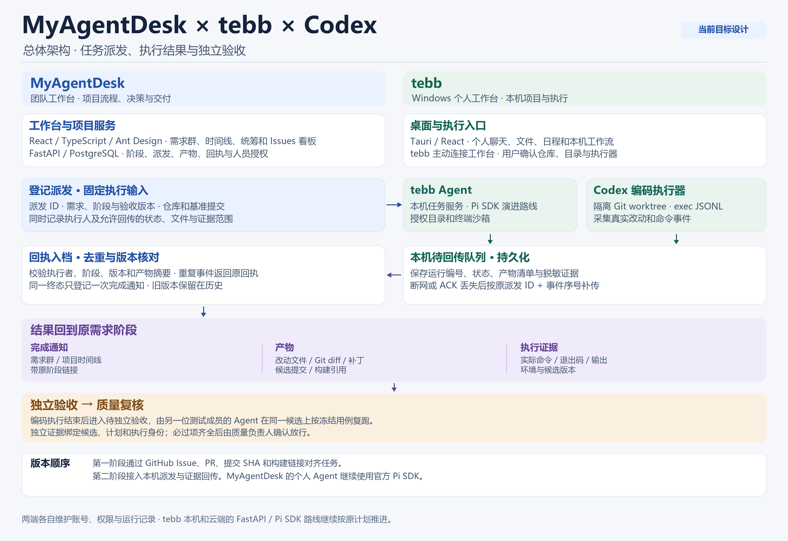
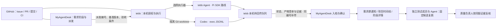

# MyAgentDesk 与 tebb 联动设计

tebb 的产品范围回到桌面个人 Agent、本机项目与工具、日程和既有云端/多端路线。需求群、跨成员交接、独立验收、项目统筹和协作状态由 MyAgentDesk 实施。两端继续使用自己的账号空间、权限和运行记录。[tebb #314](https://github.com/lkun-lea/tebb/issues/314) 是原设计索引，[MyAgentDesk 路线图](https://github.com/lkun-lea/myagentdesk/issues/1) 持有实施计划。

| 数据或操作 | 归属 |
| --- | --- |
| 需求、流程阶段、负责人、人工决定与交付结论 | MyAgentDesk |
| 本机目录权限、执行环境、个人会话、日志和命令回执 | tebb |
| 外部派发、回传记录、需求通知和共享产物索引 | MyAgentDesk |
| Codex 运行、命令事件和工作树改动 | 本机 Codex 与 tebb 执行适配器；适配器核对并归集证据 |
| Issue、PR、提交和远端 CI | GitHub，MyAgentDesk 通过授权读取 |
| 官方 Skill 内容 | tebb-skills，两端各自固定版本 |

## 第一阶段：共同引用 GitHub 记录

两端用仓库与 Issue 编号、PR、提交 SHA 或构建链接定位同一工作。MyAgentDesk 从项目需求和只读 Issues 看板打开 GitHub 原文。tebb 用户从自己的工作区打开同一链接，按本机权限进行开发。用户可将提交、构建链接或已选的验证证据添加到 MyAgentDesk，关联原需求和候选。

验收用一条已授权的 GitHub Issue。在两端打开同一个编号和提交，将候选及复跑证据挂到原需求。使用另一个账号验证私有链接和项目资料仍按各自权限读取。

## 第二阶段：tebb 与 Codex 任务派发

在需求阶段提供「在 tebb 执行」和「交给 Codex」。首个联动版本以在线、已配对且用户授权的 tebb 本机为执行入口。MyAgentDesk 登记任务并提供受鉴权的领取和结果接口，tebb 主动连接 MyAgentDesk。用户在 tebb 核对来源、执行器、仓库和目录，明确授权执行。任务链接只承载定位引用，执行和回传前均重新核验双方账号映射、项目成员、目标阶段和授权。

- **派发输入。** `dispatch_id` 对应一次执行尝试，固定项目、需求和阶段、执行器、执行人、仓库和基准提交、需求与验收版本、可回传的字段或文件范围。涉及实现时，回执另记录最终候选的提交或补丁摘要。改派、改用例或明确重新执行创建新派发，关联原尝试。两次真实执行分别留证据。
- **tebb Agent。** 复用本机任务服务，保存 `dispatch_id` 和本机运行编号的映射。由任务服务依据真实工具和执行记录形成结果。用户在 tebb 单独发起的任务可以显式选择目标项目、需求和阶段，再预览提交结果。
- **Codex。** 作为研发阶段可选编码执行器。tebb 在隔离 Git worktree 上通过 `codex exec --json` 启动，使用本机配置的 Codex 认证、获准的仓库范围和执行权限。适配器持久化 Codex 线程标识与 JSONL 事件，记录运行终态、进程退出、工具事件与错误，按实际工作树采集 diff、文件清单和基准提交，按实际命令记录采集测试输出与退出码。编程执行仍使用 Codex，MyAgentDesk 的个人 Agent 继续使用官方 Pi SDK。详见 [Codex 非交互模式](https://learn.chatgpt.com/docs/non-interactive-mode)。

### 回传内容与界面

| 内容 | 入档与展示 |
| --- | --- |
| 运行状态与结果 | 待领取、已领取、运行中、成功、失败、取消或待核对。记录派发编号、执行器、本机运行编号、完成时间及摘要。完成通知在回执提交后产生，可从需求群和项目时间线定位原阶段。 |
| 产物 | 「阶段详情 → 产物」展示实际文件清单、候选提交、Git diff、补丁、生成文件或构建引用。已授权共享的文件附内容摘要；产物缺失或上传中有独立状态。 |
| 证据 | 「阶段详情 → 验收证据」保留命令、退出码、实际输出、环境及候选版本。来源标明研发自测或独立验收；执行器摘要作为结果说明。失败或取消仍可查已授权的部分产物与日志。 |

派发时授权的状态和资料可自动回传，额外文件和日志先由用户预览选择。回传目标由派发记录确定，接收端校验授权和版本。项目共享结果以提交的证据包为限，本机令牌、完整会话和目录继续归 tebb。阶段可同时呈现「本机已完成 · 等待回传」或「回执已入档 · 产物待补」，完整候选可用后才开放对应验收。

### 断网、重试和去重

1. **领取去重。** tebb 在启动执行器前持久登记派发编号与本机运行编号。同一派发的重复打开、领取和启动请求返回原状态。进程启动或外部写入结果不明时先查询原运行和操作回执，显示待核对。用户明确重新执行时另建一次派发。
2. **回执补传。** tebb 持久保存待回传事件，键为 `dispatch_id + event_seq`，重连、重启或 ACK 丢失后用原编号和序号继续提交。相同键和内容返回已确认回执，相同键而内容不同返回冲突。按序号检查缺口，旧事件不得覆盖更新状态。凭据过期、项目撤权、用户取消或版本冲突有明确提示；撤权后停止共享。
3. **产物重传。** 文件引用使用内容摘要，接收端校验摘要、大小和项目归属。断线后补传缺失文件，已接收的文件复用原确认。结果记录、候选关联和通知事件在同一业务事务登记；通知投递按派发和终态事件编号去重。重复 ACK 只确认旧结果。
4. **处理迟到结果。** 接收时核对派发归属、阶段和输入版本。需求、候选或验收计划变化后，旧结果按历史记录保存并标明适用版本，当前阶段仍按实际版本核验。受限结果只显示当前账号允许查看的状态。

### 独立验收与放行

tebb 或 Codex 完成编码后，阶段显示「候选已提交 · 待独立验收」。研发执行者的自测与日志归该候选。另一位测试成员的 Agent 在隔离环境按冻结用例复跑，记录候选提交或补丁摘要、验收计划版本、执行者、环境、命令、退出码和实际结果。服务检查实际实现者与独立验收提交者的账号和 Agent 身份。当前版本的必过项均有有效证据后，质量负责人确认放行；失败按原流程退回实现，并保留原始失败。候选、验收条件或计划版本变化时重新核对受影响的证据。

## 验收标准

- [ ] **tebb 派发与通知。** 从一条需求的研发阶段派发本机任务，关闭或切换客户端后重新打开，按同一派发编号找到原运行。核对需求群和时间线只有一条完成通知，阶段详情可查摘要、已选产物和真实证据。取消本机授权时执行不启动。
- [ ] **断网与重放。** 分别在领取已确认但响应丢失、执行完尚未回传、服务器入档后 ACK 丢失和产物只上传一半时注入断网。重启 tebb 后恢复，核对每次派发仅启动一次、结果与通知各一条、文件摘要一致。重放旧事件及同序号不同内容，分别验证去重和冲突；结果未知的外部动作保留待核对状态。
- [ ] **Codex 实际产物。** 在固定提交的隔离 worktree 派发一个可稳定复现的缺陷，工作台能查看实际改动、候选补丁、命令、退出码和测试输出。构造测试失败、取消及缺终态，分别验证状态和部分产物，工作台可区分执行结果、回传结果与独立验收结论。
- [ ] **权限与版本。** 使用错配账号、未授权仓库、派发后撤权及不匹配的产物摘要测试拒绝。候选或验收版本变化后提交旧结果，历史可查且当前放行仍阻塞。
- [ ] **独立验收。** 两位不同成员分别实现和验收。复跑同一候选，按验收编号核对预期和实际输出。用实现者提交独立结论、用自测结果直接放行、用旧候选的通过证据放行均应被拒绝；完成同版独立验收与质量确认后才交付。

## 开发顺序

需求阶段与成员契约就绪后，先实现 [#14 tebb 派发与回执协议](https://github.com/lkun-lea/myagentdesk/issues/14)。该协议跑通 tebb Agent 后接 [#15 Codex 本机编码执行器](https://github.com/lkun-lea/myagentdesk/issues/15)。两条路径都与 [#11 独立验收和质量复核](https://github.com/lkun-lea/myagentdesk/issues/11) 联调，阶段服务负责放行。

本页是已评审的目标设计。tebb 日常运行可独立使用；自动派发、补传及 Codex 接入按路线图开发。
