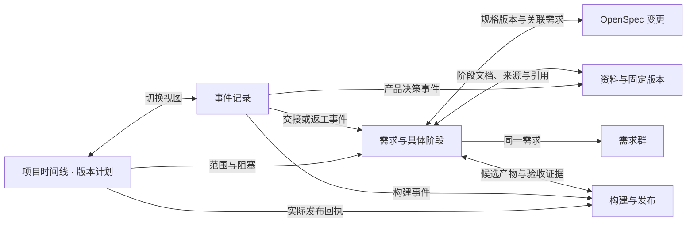

# 项目页面设计

五个页面的草图已评审。[版本时间线预览](release-timeline.html) 展示版本节点和调整日期的交互。[项目五页预览](project-pages.html) 可沿同一条示例需求切换事件记录、需求、规格、资料和构建发布。[五页可编辑源稿](project-pages.fragment.html)

| 页面 | 图稿 | 实施 issue |
| --- | --- | --- |
| [项目时间线](#项目时间线) | [版本时间线](release-timeline.html)、[事件记录](timeline.png) | [#16 版本计划](https://github.com/lkun-lea/myagentdesk/issues/16)、[#6 需求事件](https://github.com/lkun-lea/myagentdesk/issues/6)、[#4 项目导航](https://github.com/lkun-lea/myagentdesk/issues/4) |
| [需求](#需求) | [需求详情](requirements.png) | [#6 需求群和交接](https://github.com/lkun-lea/myagentdesk/issues/6)、[#7 人工决策](https://github.com/lkun-lea/myagentdesk/issues/7)、[#11 独立验收](https://github.com/lkun-lea/myagentdesk/issues/11) |
| [规格](#规格) | [OpenSpec](specs.png) | [#10 规格与校验](https://github.com/lkun-lea/myagentdesk/issues/10) |
| [资料](#资料) | [资料目录与正文](materials.png) | [#6 项目上下文](https://github.com/lkun-lea/myagentdesk/issues/6) |
| [构建与发布](#构建与发布) | [构建与发布](build-release.png) | [#11 证据和交付](https://github.com/lkun-lea/myagentdesk/issues/11) |

## 跳转关系

跳转保留项目、目标记录及适用版本。进入历史事件时定位到当时的阶段、证据或构建，当前运行阶段有单独标识。返回时恢复来源页已选范围和滚动位置。服务对详情、原件、构建产物与深链接重复核验授权。权限回收后显示当前状态并移除受限内容。

## 项目时间线

项目默认打开「版本时间线」。成员查看验收里程碑、目标和实际发布日期，点版本展开范围、必过项、阻塞和版本决定。未排期的需求和无日期的版本可单独查看。项目负责人调整范围或日期时先核对影响，再保存原因和修订记录。

「事件记录」按项目、日期和持久事件序号展示历史，点击交接、返工、产品决定或构建定位原记录。查看 [版本草图](release-timeline.html)、[事件草图](timeline.png) 和 [版本交互与验收](../RELEASE_PLAN.md#时间线交互)。

- [ ] 版本详情能定位阻塞及其负责人、下一步和期限。修改范围后计数更新，历史能查到原计划；目标日期和实际发布分别展示。
- [ ] 两条需求并行，生成交接、返工、决定及构建。进入项目看到该项目事件；点击旧候选返工定位原失败证据，点击当前需求定位最新阶段。
- [ ] 返回保留原位置；断线后按游标补读并去重，失败后可重试，跨项目事件与受限标题不出现。

## 需求

需求列表展示版本、当前阶段、负责人和状态。详情显示需求确认、实现与自测、独立验收、质量复核四阶段。点击节点切换摘要、文档、产物和验收证据，可跳到同一需求群、规格、资料原件或构建。Agent 上下文展示当前带入的需求、验收条件与职责，以及可按需读取的来源。

- [ ] 分别以研发和测试成员完成一次交接与返工。同一候选的实际实现者提交独立验收结论被拒绝。群和需求详情显示同一阶段、责任人、候选与证据。
- [ ] 切换历史节点只改变查看内容。更换候选后旧证据可查且标明失效，逐项验收和质量放行使用当前有效证据。等待人决定时，确认后按原运行检查点与授权恢复。
- [ ] 四类详情分别覆盖空数据、加载失败和撤权。按运行编号核对实际采用的上下文片段、版本及来源。
- [ ] 已授权 GitHub Issue 可关联到需求，重复关联返回原记录。关闭 GitHub Issue 只更新来源状态。原决策人离开后，合格替补可打开同一决定与证据，旧入口不能再提交。

## 规格

活动变更与历史归档分区。选中变更可查看仓库、分支、提交、提案、设计、行为规格和任务清单。授权用户从活动变更运行校验并打开回执，历史快照可查其当时内容。可从需求实现阶段直达具体变更。

- [ ] 从需求和规格页打开同一变更版本；依次打开四类文件，并核对命令、退出码、输出及提交版本。
- [ ] 切换分支或在仓库修改规格后，旧回执不再代表当前校验。涉及验收范围的变更进入产品确认。越权读取或调用校验时返回明确反馈。

## 资料

左侧目录显示项目说明、产品决定和验收资料。选中后在右侧阅读正文、可读范围、来源、当前或历史版本，能打开原件或关联需求。Agent 根据当前任务读取授权来源和必要片段，运行详情留存实际引用。

- [ ] 从时间线的决定事件或需求阶段文档定位同一来源及固定版本。确认目录、原文、版本和运行引用可互相追踪。
- [ ] 用两个项目的同名文档及受限需求群验证搜索、预览、引用和直达权限。更新版本后历史引用仍指向原版本；撤权后重新打开得到授权提示。

## 构建与发布

选择构建记录，查看集成提交、CI 日志、候选包与产物摘要。发布准备逐项显示需求验收、同一构建的必过回归和质量放行。历史发布可查计划修订、发布人、渠道和实际回执。

- [ ] 构造一个失败构建和一个构建成功但验收未完成的候选。失败构建展示退出码和日志；成功构建可查包及校验摘要，发布状态仍显示缺项。
- [ ] 绑定对应版本的验收和质量放行后，由有发布权限的人确认。核对历史发布、回执、构建和候选标识一致。注入越权、旧候选证据与重复确认，核对不产生错误或重复发布。
- [ ] 两条需求分别通过后，构建一个不同提交或不同摘要的新包。直到同一构建的回归和放行齐备才可确认发布。正式渠道回执到账后，版本时间线显示实际发布。

## 开发与验证

按 [首版路线图](https://github.com/lkun-lea/myagentdesk/issues/1) 的开发前置推进。页签、表单、列表、抽屉、步骤与状态反馈优先使用 [Ant Design](https://ant.design/components/overview/)，视觉与操作标准见 [AGENTS.md](../../../AGENTS.md)。评审通过的草图是交互参考，产品验收使用真实页面和服务回执。
